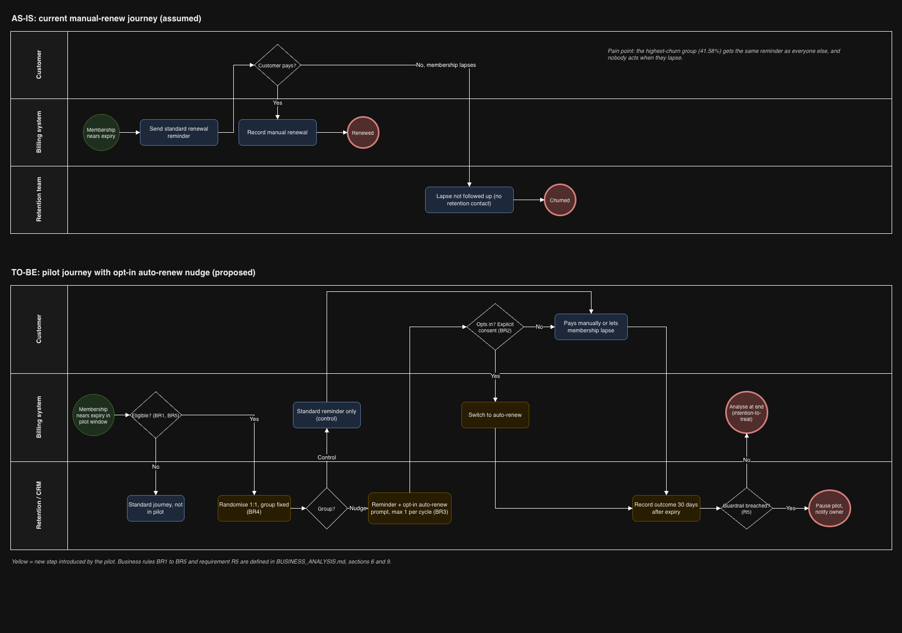

# KKBox Churn: Should a Retention Team Pilot an Auto-Renew Nudge?

**Manual-renew subscribers churned at 41.58%, against 4.37% for auto-renew subscribers.** I built a churn model, then tested it against a one-line rule. At the same contact budget the model did not beat the rule. The recommendation is therefore a controlled, costed pilot of an opt-in auto-renew nudge, targeted by the simple manual-renew rule, not a model-led rollout.

Data: a 7,500-customer random sample (seed 42) from the WSDM KKBox churn competition data, with features cut off at 2017-02-28. All figures are sample figures, not company-wide numbers.

**Tools, and what each was used for:** SQL for the early data layer (now historical), Python for data preparation, statistics, modelling and the benchmark, Excel for the business case and pilot sizing, and Power BI for the management dashboard.

## Recommendation

1. **Approve the pilot design, not a rollout.** Randomise eligible manual-renew customers 1:1 into an opt-in auto-renew prompt or the standard reminder. Primary metric: churn 30 days after membership expiry.
2. **Target with the manual-renew rule, not the model.** The rule is free, explainable and matched the model in the benchmark below. Use the model only if Retention can contact fewer than about 10% of customers, where its top-ranked customers are more precise.
3. **Run the nudge without a price incentive.** In the business case, the no-incentive design breaks even at under 1 point of churn reduction. A 30 NTD incentive raises break-even to about 4.3 points.
4. **If the pilot fails, stop.** If churn does not fall significantly, or falls by less than the break-even reduction, do not roll out. Keep the standard journey and test a different lever (for example, reminder timing) with the same protocol. If a guardrail (complaints, unsubscribes, payment disputes) is breached, pause the pilot immediately.

## Key findings

| Finding | Result |
|---|---|
| Overall churn | 711 of 7,500 customers (9.48%) |
| Auto-renew vs manual-renew churn | 4.37% (6,470 customers) vs 41.58% (1,015 customers) |
| Adjusted association | Auto-renew is associated with about 84% lower odds of churn (odds ratio 0.157, after adjusting for the other variables in the explanatory regression, `10_logistic_regression.py`). This is an association: loyal customers may simply choose auto-renew |
| Recency | Customers whose latest transaction was 31+ days before the cutoff churned at 76.42% (352 customers). This is closely tied to how churn is defined, so it is a risk indicator, not an independent explanation |
| Recent listening | No clear difference between churned and retained customers (8.18% to 10.64% across activity groups) |
| Model (held-out test, threshold 0.10) | Precision 42.1% (95% interval 35.4% to 48.7%), recall 65.5% (57.8% to 73.1%), ROC-AUC 0.8191 |
| Ranking | The top risk decile churned at 51.33%; the top two deciles capture 69.7% of churners |

## Benchmark: model vs simple rules

Same 1,500 held-out test customers (142 churners), same number of customers contacted. Source: `24_benchmark_rules.py`, `benchmark_model_vs_rules.csv`.

| Approach | Contacted | Churners caught | Precision |
|---|---|---|---|
| Rule: manual-renew | 200 (13.3%) | 83 | 41.5% |
| Model, same budget | 200 (13.3%) | 85 | 42.5% |
| Rule: manual-renew OR 31+ days lapsed | 223 (14.9%) | 99 | 44.4% |
| Model, same budget | 223 (14.9%) | 93 | 41.7% |
| Model, top 10% | 150 (10.0%) | 77 | 51.3% |

The two-customer gap at 200 contacts is too small to call the model better. Both rules came from earlier descriptive work on the full sample, so they had a small head start, and "31+ days lapsed" overlaps with the churn definition.

## Business analysis

| Deliverable | What it contains |
|---|---|
| [BUSINESS_ANALYSIS.md](BUSINESS_ANALYSIS.md) | Decision and owner, options, RACI, KPI definitions, business rules, pilot protocol, requirements with acceptance criteria, assumption and risk log |
| [business_case.xlsx](business_case.xlsx) | Costed scenarios (Low, Base, Base + incentive, High), break-even, sensitivity table, pilot sample size and an assumption log. Built by `25_make_business_case.py`; all results are live formulas |
| [docs/process_as_is_to_be.drawio](docs/process_as_is_to_be.drawio) | Current and proposed renewal process with swimlanes and business rules. Open it at app.diagrams.net |



**Business case at a glance** (sample scale, assumptions marked in the workbook): with a 5-point churn reduction and no incentive, net value is about 10,800 NTD on 1,015 customers. Adding a 30 NTD incentive cuts it to about 1,700 NTD. The pilot needs about 1,491 customers per arm to detect a 5-point drop. Whether that is feasible depends on monthly eligible volume at full scale, which is an assumption to confirm, not a sample figure. These are what-ifs, not forecasts.

## Dashboard

Built in Power BI (online) from summary tables only. See `dashboard_outputs/kkbox_dashboard_data.xlsx` for the data behind it.


**Known issues in the screenshots.** The report was built with a university account that I can no longer access, so I could not correct these:
- Page 1: "transition" should read "transaction" in the limitation text.
- Page 3: "14.198%" should read 14.98%, and "let out" should read "left out".
- Page 4: the metrics table shows a meaningless total row, and the gains chart axis starts at 50.
- Page 2: the revenue scenario shown is an older gross, cost-free version. The current, costed figures are in `business_case.xlsx`.

The data in `dashboard_outputs/` is correct, and the dashboard can be rebuilt from it.

## Method

1. Build a cutoff-safe dataset: only transactions and listening on or before 2017-02-28 are used as features.
2. Validate the dataset and run statistical tests and an explanatory logistic regression.
3. Evaluate a prediction model on a stratified 80/20 split. The threshold (0.10) was selected using training-only out-of-fold predictions; final metrics use the fixed seed-42 holdout. The holdout was later reused for the rule benchmark (`24_benchmark_rules.py`), which compares targeting approaches but changes no model choice.
4. Test whether recent-listening features improve the model (they do not meaningfully).
5. Benchmark the model against simple targeting rules at equal contact budgets.
6. Export summary tables for the dashboard and build the business case.

## Limitations

- Data are from 2017, and the split is random, not temporal. The model's results say nothing about future performance.
- Findings are associations. The analysis cannot show that changing renewal type causes lower churn; that is what the pilot would test.
- Only 15 sample customers have no transaction history, so that group supports no conclusions.
- Same-day transactions are ordered by transaction date, expiry date and cancel flag with a stable sort. This is reproducible but has not been verified as KKBox's official rule. It affected 54 customers (0.72%) and changed no conclusion.
- Revenue uses NTD amounts: latest paid amount divided by plan days, times 30.
- See `DATA_PROVENANCE.md` for sources, the unreproduced earlier audit figure (133 vs 15 customers without history) and decisions.

## Repository guide

| Item | Purpose |
|---|---|
| `02` to `07` | Sampling, loading, validation and the cutoff-safe model dataset |
| `08`, `09`, `10` | Statistical analysis and logistic regression |
| `11`, `14`, `15` | Model evaluation, threshold selection and final test |
| `12`, `13`, `16`, `17` | Tie-break comparison, KPI rebuild and checks |
| `18`, `19`, `20` | Recent-listening features and their test |
| `21`, `22` | Dashboard summary tables and workbook |
| `24` | Benchmark: model vs simple rules at equal contact budgets |
| `25` | Builds `business_case.xlsx` |
| `docs/` | Process diagram and dashboard screenshots |
| `sql_analysis/` | **Earlier version.** Built on an older sample (`_v2` files), so its figures differ from the corrected analysis above |
| `dashboard_outputs/` | Summary tables used by the dashboard |

## Running it

The raw data is not included and cannot be redistributed. Download it from the WSDM KKBox churn competition on Kaggle and place the files in `raw_data/`. Customer-level outputs are never published.

```
pip install -r requirements.txt
python3 06_build_model_dataset.py
python3 10_logistic_regression.py
python3 14_select_threshold.py
python3 15_final_test_evaluation.py
python3 18_build_recent_usage.py
python3 21_export_dashboard_tables.py
python3 22_make_dashboard_workbook.py
python3 24_benchmark_rules.py
python3 25_make_business_case.py
```

Status: a clean clone installs from requirements.txt (Python 3.12) and all scripts compile without errors. `06_build_model_dataset.py` reads the 7,500-customer sample list `Project_2_KKBox_Churn_Analysis.csv`, which was produced in the earlier SQL stage and is not regenerated by a script in this repository. The full pipeline has not been re-run from a clean clone, so end-to-end reproduction is unverified.

## Data privacy

Customer-level files (raw data, model dataset, predictions) are excluded by `.gitignore`. Scripts read the database password from the `POSTGRES_PASSWORD` environment variable.

## Data dictionary

Column definitions for the model dataset and the dashboard tables are in [DATA_DICTIONARY.md](DATA_DICTIONARY.md).
