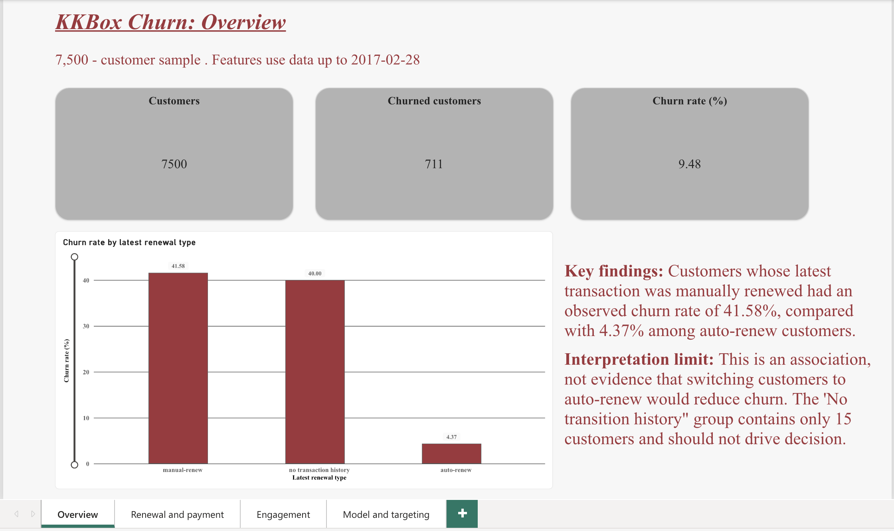
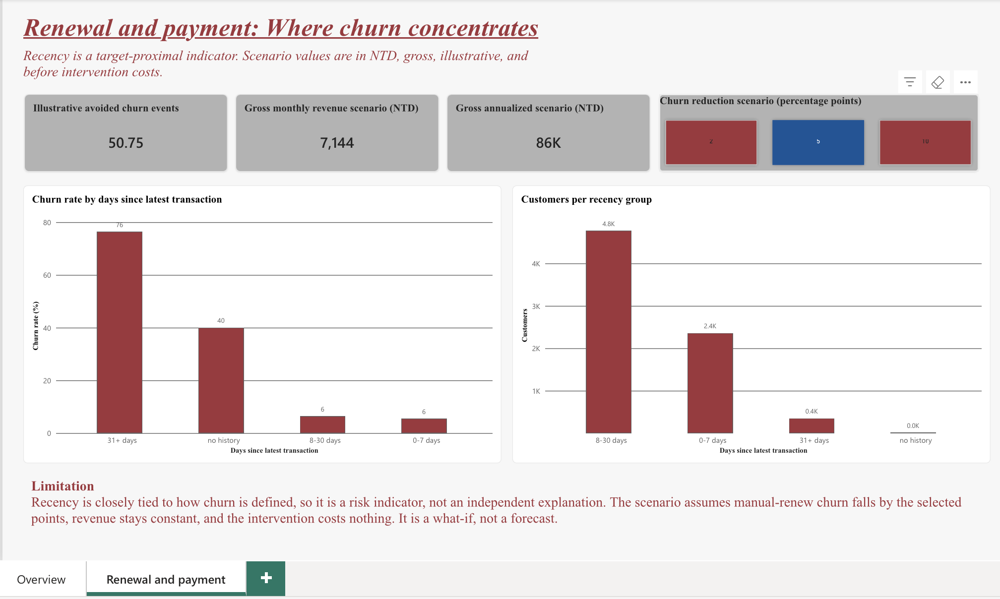
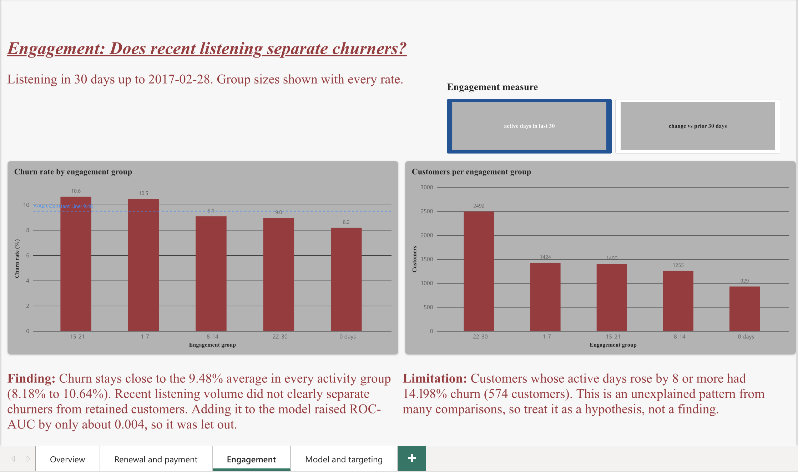
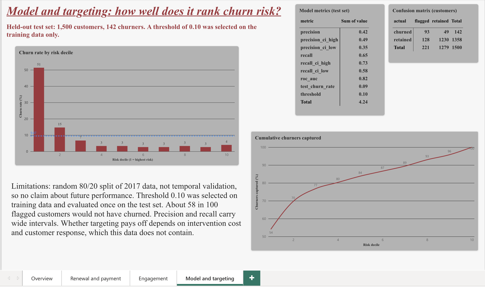

# KKBox Customer Churn and Retention Analysis

An end-to-end analysis of subscription churn using SQL, Python, Excel and Power BI. The goal is to understand which customer characteristics are associated with churn, how well customers can be ranked by churn risk, and which segments a retention team should test first.

Data: a 7,500-customer random sample (seed 42) from the WSDM KKBox churn competition data. Features use data up to the cutoff date, 2017-02-28.

## Key findings

| Finding | Result |
|---|---|
| Overall churn | 711 of 7,500 customers (9.48%) |
| Auto-renew vs manual-renew churn | 4.37% (6,470 customers) vs 41.58% (1,015 customers) |
| Adjusted association | Auto-renew is associated with about 84% lower odds of churn (odds ratio 0.157) |
| Recency | Customers whose latest transaction was 31+ days before the cutoff churned at 76.42% (352 customers). This is closely tied to how churn is defined, so it is a risk indicator, not an independent explanation |
| Recent listening | No clear difference between churned and retained customers (8.18% to 10.64% across activity groups) |
| Model (held-out test, threshold 0.10) | Precision 42.1% (95% interval 35.4% to 48.7%), recall 65.5% (57.8% to 73.1%), ROC-AUC 0.8191 |
| Ranking | The top risk decile churned at 51.33%; the top two deciles capture 69.7% of churners |
| Model vs simple rule | At the same contact budget the model did not beat a rule. Manual-renew alone caught 83 of 142 test churners (model: 85). Manual-renew OR 31+ days lapsed caught 99 (model: 93). The model only helps if fewer than about 10% of customers can be contacted. See `benchmark_model_vs_rules.csv` |

These are observed associations, not proof of cause. Switching customers to auto-renew might not produce the same drop in churn.

## Dashboard

Built in Power BI (online) from summary tables only. See `dashboard_outputs/kkbox_dashboard_data.xlsx` for the data behind it.






**Known issues in the screenshots.** The report was built with a university account that I can no longer access, so I could not correct these:
- Page 1: "transition" should read "transaction" in the limitation text.
- Page 3: "14.198%" should read 14.98%, and "let out" should read "left out".
- Page 4: the metrics table shows a meaningless total row, and the gains chart axis starts at 50.
- Page 2: some values are rounded (86K and 7,144). The exact figures are 85,724.34 and 7,143.70 NTD.

The data in `dashboard_outputs/` is correct, and the dashboard can be rebuilt from it.

## Method

1. Build a cutoff-safe dataset: only transactions and listening on or before 2017-02-28 are used as features.
2. Validate the dataset and run statistical tests and an explanatory logistic regression.
3. Evaluate a prediction model on a stratified 80/20 split. The threshold (0.10) was selected using training-only out-of-fold predictions; final metrics use the fixed seed-42 holdout. The holdout was later reused for the rule benchmark (`24_benchmark_rules.py`), which compares targeting approaches but changes no model choice.
4. Test whether recent-listening features improve the model (they do not meaningfully).
5. Export summary tables for the dashboard.

## Scenario (illustrative)

If manual-renew churn fell by 5 percentage points, about 50.75 churn events would be avoided, worth about 7,143.70 NTD a month (85,724.34 NTD a year) in gross revenue. This assumes revenue stays constant and the intervention costs nothing. It is a what-if, not a forecast. A randomized pilot would be needed to test the effect.

## Limitations

- Data are from 2017, and the split is random, not temporal. The model's results say nothing about future performance.
- Findings are associations. The analysis cannot show that changing renewal type causes lower churn.
- Only 15 sample customers have no transaction history, so that group supports no conclusions.
- Same-day transactions are ordered by transaction date, expiry date and cancel flag with a stable sort. This is reproducible but has not been verified as KKBox's official rule. It affected 54 customers (0.72%) and changed no conclusion.
- Revenue uses NTD amounts: latest paid amount divided by plan days, times 30.
- See `DATA_PROVENANCE.md` for sources, the unreproduced earlier audit figure (133 vs 15 customers without history) and decisions.

## Repository guide

| Item | Purpose |
|---|---|
| `02` to `07` | Sampling, loading, validation and the cutoff-safe model dataset |
| `08`, `09`, `10` | Statistical analysis and logistic regression |
| `11`, `14`, `15` | Model evaluation, threshold selection and final test |
| `12`, `13`, `16`, `17` | Tie-break comparison, KPI rebuild and checks |
| `18`, `19`, `20` | Recent-listening features and their test |
| `21`, `22` | Dashboard summary tables and workbook |
| `sql_analysis/` | **Earlier version.** Built on an older sample (`_v2` files), so its figures differ from the corrected analysis above |
| `dashboard_outputs/` | Summary tables used by the dashboard |

## Running it

The raw data is not included and cannot be redistributed. Download it from the WSDM KKBox churn competition on Kaggle and place the files in `raw_data/`. Customer-level outputs are never published.

```
pip install -r requirements.txt
python3 06_build_model_dataset.py
python3 10_logistic_regression.py
python3 14_select_threshold.py
python3 15_final_test_evaluation.py
python3 21_export_dashboard_tables.py
```

Status: a clean clone installs from requirements.txt (Python 3.12) and all scripts compile without errors. The full pipeline was not re-run from a clean clone because the raw data cannot be redistributed, so reproducing the numbers requires the Kaggle files.

## Data privacy

Customer-level files (raw data, model dataset, predictions) are excluded by `.gitignore`. Scripts read the database password from the `POSTGRES_PASSWORD` environment variable.
## Business analysis

Problem statement, stakeholders, KPI definitions, requirements and a pilot design are in [BUSINESS_ANALYSIS.md](BUSINESS_ANALYSIS.md). Stakeholder roles are assumed for illustration.

## Data dictionary

Column definitions for the model dataset and the dashboard tables are in [DATA_DICTIONARY.md](DATA_DICTIONARY.md).
